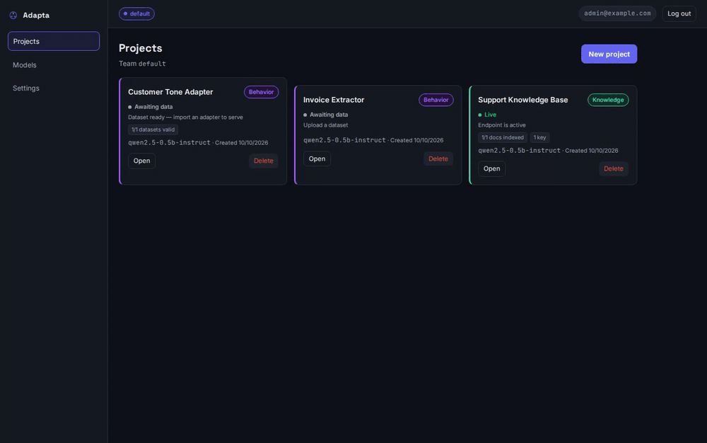

<div align="center">

# 

### Your model. Your data. Your servers.

**Adapta is a self-hosted platform for customizing and serving private language models.**
Give a model your **knowledge** (cited retrieval) and your **behavior** (an adapter you bring),
and serve both behind a single **OpenAI-compatible** endpoint — on hardware you control.

[](https://github.com/yielab/adapta/actions/workflows/ci.yml)
[](LICENSE)
[](https://www.python.org/downloads/release/python-3110/)
[](docker-compose.yml)
[](#using-the-api)
[](#-documentation)

[**Documentation**](#-documentation) · [**Quick start**](#-quick-start-5-minutes-cpu) · [**Using the API**](#using-the-api) · [**How it works**](#how-it-works) · [**Roadmap**](TODO.md)



</div>

---

## What is Adapta?

Adapta runs **on-premise**. A team deploys it on their own server, creates **Projects**, and each
project becomes a private model endpoint consumed with a scoped API key. **No data ever leaves your
infrastructure** — there is no telemetry and no callback to any external service.

It answers two needs that have no good *private* solution today:

- 📚 **Give it knowledge (RAG)** — answer from *your* documents, with citations. Retrieval is
  **hybrid**: semantic vector search *and* Postgres full-text keyword search over the whole corpus, fused and re-scored by a
  cross-encoder reranker, so exact terms (product codes, names) survive alongside meaning. The
  model's weights never change. **CPU-only.**
- 🎛️ **Change how it behaves (bring your own adapter)** — import a GGUF/PEFT LoRA, gate it on CPU against the base on your eval set, then serve it (import flow: roadmap E4.2–E4.4, not built yet). In-product training was removed on 2026-10-10; no service needs a GPU.

And knowledge and behavior **compose on a single endpoint**: facts retrieved from your documents
(cited) *and* the tone/format of your adapter, in the same call.

No confirmed competitor combines all of these in one self-hosted product. vLLM and LoRAX serve
adapters at scale but do no RAG. H2O LLM Studio trains LoRA/QLoRA (including DPO) but
has no serving or RAG. AnythingLLM does RAG but has no adapter lifecycle. NVIDIA NeMo covers most of the
surface but requires Kubernetes and 10+ microservices. See the
[competitive landscape](docs/reference/COMPETITIVE_LANDSCAPE.md) for the full comparison matrix with
citations.

> [!IMPORTANT]
> **Status: working prototype — a one-person, AI-assisted (Claude) project.** The full lifecycle
> works end-to-end for RAG and multi-tenant serving (adapter import and its eval gate are being rebuilt),
> but it is **not production-hardened**: the auth path should be reviewed independently before being trusted with sensitive data.
> Apache-2.0 licensed and built for private-team use — if you deploy it, expect to audit and harden it yourself.

---

## 📖 Documentation

Full documentation is a **MkDocs Material** site built from [`docs/`](docs/) and published to GitHub
Pages (`mkdocs build --strict` runs in CI, so internal links never rot). Once the stack is running,
interactive API docs are live at **`/docs`**.

| Audience | Start here |
| --- | --- |
| **Using the console / API** | [User Guide](docs/user-guide/index.md) — console walkthrough, consuming the API, [knowledge + behavior together](docs/user-guide/knowledge-and-behavior.md) |
| **Building on / contributing** | [Developer Guide](docs/developer-guide/index.md) — architecture, contract-driven workflow, and [Learning the system](docs/developer-guide/learning-the-system.md) (RAG, embeddings, LoRA, GGUF and the eval gate idea, explained with backend analogies) |
| **Operating it** | [Operations](docs/reference/OPERATIONS.md) — backup/restore, upgrades, host sizing, hardening checklist |
| **Reference** | [Product definition](docs/reference/PRODUCT_DEFINITION.md) · [API reference](docs/reference/api.md) · [SDD workflow](docs/reference/SDD_WORKFLOW.md) · [Changelog](CHANGELOG.md) · [ADRs](docs/adr/) |
| **What's planned** | [Roadmap (TODO.md)](TODO.md) — the only place with open work |

---

## 🚀 Quick start (5 minutes, CPU)

**Prerequisites:** Docker + Docker Compose. No GPU is needed.

```bash
# 1. Clone
git clone https://github.com/yielab/adapta && cd adapta

# 2. Start the stack  (= docker compose up -d --build)
make up
```

`make up` runs migrations, healthchecks Postgres/Redis/Chroma, waits for the app, and prints the
service map.

```bash
# 3. Download the default base GGUF into ./data/models/  (Apache-2.0, runs on any host)
huggingface-cli download Qwen/Qwen2.5-1.5B-Instruct-GGUF \
  qwen2.5-1.5b-instruct-q4_k_m.gguf \
  --local-dir ./data/models/qwen2.5-1.5b
```

**4. Open the console → [http://localhost:8000/console/](http://localhost:8000/console/)** and sign in
with the seeded admin `admin@example.com` / `admin12345` (or register to create a new organization).

From there: create a **RAG** project → upload documents → create an endpoint + API key → try the
playground. The console hands you a copy-paste OpenAI snippet at the end of every flow.

<details>
<summary><b>Service map, health checks & supported models</b></summary>

Re-print the service map any time with `make status`:

| Service | URL / port |
| --- | --- |
| **Console (web UI)** | <http://localhost:8000/console/> |
| API base · Swagger | <http://localhost:8000> · <http://localhost:8000/docs> |
| Health (liveness · deep) | <http://localhost:8000/health> · `/health/deep` |
| Postgres · Redis · ChromaDB | `localhost:5432` · `localhost:6379` · `localhost:8001` |

```bash
docker compose ps                       # every service should be "healthy"
curl http://localhost:8000/health       # → {"status":"ok"}
docker compose logs app                 # if app is restarting
```

Base models the catalog validates against (see [Operations §6](docs/reference/OPERATIONS.md)):

| Model | HF repo | Serve RAM (Q4) |
| --- | --- | --- |
| Qwen2.5-0.5B-Instruct (Apache-2.0) | `Qwen/Qwen2.5-0.5B-Instruct-GGUF` | ~2 GB |
| Qwen2.5-1.5B-Instruct (Apache-2.0, **default**) | `Qwen/Qwen2.5-1.5B-Instruct-GGUF` | ~3 GB |
| Qwen2.5-3B-Instruct (research license — evaluation only) | `Qwen/Qwen2.5-3B-Instruct-GGUF` | ~4 GB |
| Qwen2.5-Coder-3B (research license — evaluation only) | `Qwen/Qwen2.5-Coder-3B-Instruct-GGUF` | ~4 GB |
| Qwen2.5-7B-Instruct (Apache-2.0) | `Qwen/Qwen2.5-7B-Instruct-GGUF` | ~8 GB |
| Qwen2.5-VL-3B (vision, research license — evaluation only) | GGUF + mmproj | ~3.5 GB |
| Qwen2.5-VL-7B (vision, Apache-2.0) | GGUF + mmproj (`ggml-org/Qwen2.5-VL-7B-Instruct-GGUF`) | ~8 GB |

Prefer the API? `curl -X POST http://localhost:8000/v1/auth/register -H 'Content-Type: application/json' -d '{"org_name":"Acme","email":"admin@acme.com","password":"changeme123"}'`

</details>

> [!WARNING]
> **Before exposing the stack beyond localhost:** set a real `ADAPTA_SECRET_KEY`
> (`openssl rand -hex 32`), change the default Postgres password, and change or disable the seeded
> admin (`ADAPTA_SEED_DEFAULT_ADMIN=0`) — it is a well-known credential from a public repo. Copy
> `.env.example` to `.env` to override settings. See [Security](#security).

---

## Using the API

Point any OpenAI SDK at your server; use the project's **endpoint slug** as the model and its scoped key:

```python
from openai import OpenAI

client = OpenAI(base_url="http://localhost:8000/v1", api_key="adp_xxxx…")  # key scoped to one endpoint

resp = client.chat.completions.create(
    model="support-kb-a1b2c3d4",        # your endpoint slug (shown in the console)
    messages=[{"role": "user", "content": "What is our refund window?"}],
)
print(resp.choices[0].message.content)  # RAG answers include citations
```

Vision endpoints accept standard OpenAI image content-parts as inline base64 `data:` URLs (the
server never fetches remote URLs):

```python
messages=[{"role": "user", "content": [
    {"type": "image_url", "image_url": {"url": data_url}},
    {"type": "text", "text": "Extract vendor, date and total as JSON."},
]}]
```

`POST /v1/chat/completions` is the only external protocol your application calls.

---

## How it works

```text
              Company's own server  (docker compose up)
   ┌─────────────────────────────────────────────────────────┐
   │   browser → /console/   ←── Vite + Svelte operator UI    │
   │                                                          │
   │   app (FastAPI) ──────────────────────────► PostgreSQL   │
   │     │   control plane + RAG data plane                   │
   │     ├─── RAG pipeline ──► ChromaDB (per-project vectors) │
   │     └─── Job queue ──► Redis ──► worker (app image)      │
   │                                                          │
   │   Inference (llama-cpp, CPU): base GGUF + GGUF LoRA      │
   └─────────────────────────────────────────────────────────┘
```

| Container | Role |
| --- | --- |
| `app` | Control plane + RAG serving + operator console (static SPA at `/console/`) |
| `worker` | Same image as `app`; consumes the Redis queue and dispatches on job kind (no handlers yet) |
| `postgres` · `redis` · `chroma` | System of record · job queue · per-project RAG vectors |

A finetune project that also indexes documents serves both at once once an adapter can be imported
(E4.2–E4.4) — see [Knowledge + behavior together](docs/user-guide/knowledge-and-behavior.md).

<details>
<summary><b>Tech stack</b></summary>

| Layer | Technology |
| --- | --- |
| HTTP framework | FastAPI + Uvicorn |
| API validation | Pydantic v2 (generated from the OpenAPI spec) |
| Inference | llama-cpp-python (GGUF models) |
| Vector store · Embeddings | ChromaDB (per-project) · sentence-transformers |
| Retrieval | Hybrid: vector + Postgres FTS, fused via Reciprocal Rank Fusion, cross-encoder reranker |
| Metadata DB | PostgreSQL + SQLAlchemy 2.x (async) + Alembic |
| Job queue | Redis + `redis.asyncio` (BLPOP worker) |
| Operator console | Vite + Svelte 5 + TypeScript (static SPA, served same-origin) |
| Deploy | Docker Compose, customer-operated |

</details>

---

## Where Adapta fits

Adapta is the **model-customization-and-serving layer**: upload data, specialize a model, get an
endpoint. The value is the *intersection* — not the individual pieces, which mature tools do at
larger scale.

| Capability | Dify / RAGFlow / AnythingLLM | Unsloth / LLaMA-Factory | **Adapta** |
| --- | :---: | :---: | :---: |
| Self-hosted RAG with citations | ✅ | — | ✅ |
| Integrated LoRA training | — | ✅ | — (bring your own adapter) |
| Eval gate blocks a weak adapter | — | — | 🚧 (rebuilt on CPU in E4.3) |
| RAG + adapter composed on one endpoint | — | — | ✅ |
| Multi-tenant orgs / teams / RBAC | partial | — | ✅ |
| OpenAI-compatible serving | ✅ | — | ✅ |

**It is *not*** a workflow/agent builder (Dify, n8n), a deep-document/OCR parser (RAGFlow, Haystack),
an end-user chat UI (Open WebUI — the console here is for admin/setup), or a high-throughput
inference server (vLLM, TGI). Bring those yourself.

---

## Security

Privacy is the whole pitch — your data stays on your hardware — so the obligations are specific,
especially for an unaudited prototype. **The [Quick start](#-quick-start-5-minutes-cpu) warning lists
what to change before exposing the stack.** Beyond that, put it behind a TLS reverse proxy and keep
Postgres/Redis off any public network.

**What the platform does for you:** no telemetry or external callbacks · a weak adapter is blocked
from serving mechanically (not by a flag; gate being rebuilt, E4.3) · cross-tenant isolation enforced at the ORM layer and
tested as typed 403s · uploads are bounded against oversized/hostile input
(streamed byte caps — [Operations §6.4](docs/reference/OPERATIONS.md)) and validation reports every bad row in one pass.

**What to audit yourself:** JWT/bcrypt paths (`adapta/services/auth.py`), invite-token handling, and the synthesis endpoint's injection surface.

Full hardening checklist and secret management: [Operations](docs/reference/OPERATIONS.md) ·
report a vulnerability via [SECURITY.md](SECURITY.md).

---

## Project status

Phases 0–5 shipped (history in [CHANGELOG.md](CHANGELOG.md)). In-product training was removed on
2026-10-10 (E4.1): no CUDA worker, vLLM or GPU gates remain. The open work is the 2026-09-03 audit,
roadmap §E, in [TODO.md](TODO.md): *bring your own adapter* (import, CPU eval gate, serve with RAG),
real hybrid retrieval on Postgres and OCR ingestion.

<details>
<summary><b>Capability matrix</b></summary>

| Capability | Status |
| --- | --- |
| Operator console (RAG lifecycle, datasets, endpoint+keys, playground, usage) | ✅ Done |
| OpenAI-compatible serving (base + GGUF LoRA adapter, key-scoped) | ✅ Done |
| RAG retrieval with citations (sentence-transformers; PDF/DOCX/MD/TXT/HTML; per-project ChromaDB) | ✅ Done |
| Adapter import + CPU eval gate (unverified adapter never serves) | 🚧 Roadmap E4.2–E4.4 |
| Dataset synthesis (indexed docs → LLM Q/A pairs → JSONL) | ✅ Done |
| Combined serving (retrieval + adapter in one call) | ✅ Done (adapter path; import pending) |
| Auth / teams / RBAC (bcrypt + JWT; invite flow; cross-team access is a typed 403) | ✅ Done |
| Usage metering (per-endpoint daily token rollup) | ✅ Done |
| API contract (schemathesis `--checks all`, zero 5xx, all operations; models generated + consumed by routers) | ✅ Done |
| Error handling (`DomainError` taxonomy, one envelope, correlation IDs, 0 `detail=str(e)` sites) | ✅ Done |
| Test coverage (in-process + integration suites; ~50% line coverage, 30% floor enforced) | 🚧 Ratcheting |
| Image *generation* / multimodal RAG | 🗑️ Out of scope |

</details>

---

## Contributing

Contributions are welcome — document-parser
formats, base-model catalog entries, console UX, embedding options, and eval-metric additions.

Adapta is **contract-driven** (Extended SDD): change the contract before the code.

| Contract | Source of truth | Merge gate |
| --- | --- | --- |
| **API** | `specs/openapi.yaml` | `make test-contracts` (schemathesis) |
| **DB schema** | Alembic migrations | `make migrate-test` (up/down) |
| **Model/eval set** | eval-dataset JSON Schema + eval threshold | the CPU eval gate (E4.3, not built yet) |

```bash
docker compose exec app make ci    # check-leaks + lint + lint-imports + coverage + validate-spec + check-models
```

Start with [CONTRIBUTING.md](CONTRIBUTING.md) and the [SDD workflow](docs/reference/SDD_WORKFLOW.md).
Please follow the [Code of Conduct](CODE_OF_CONDUCT.md).

---

## License & author

[Apache-2.0](LICENSE) — © Santiago Yie (Senior Backend / Platform Engineer).
